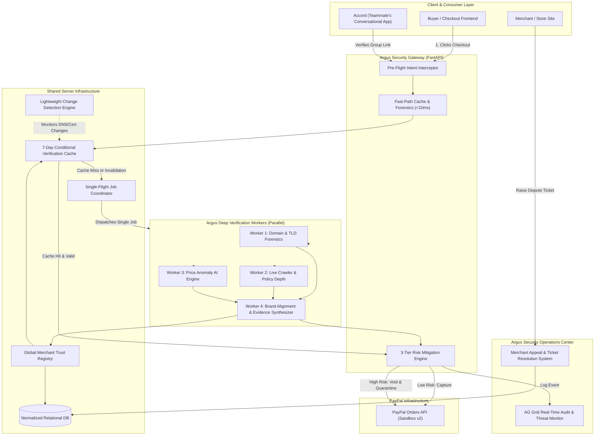
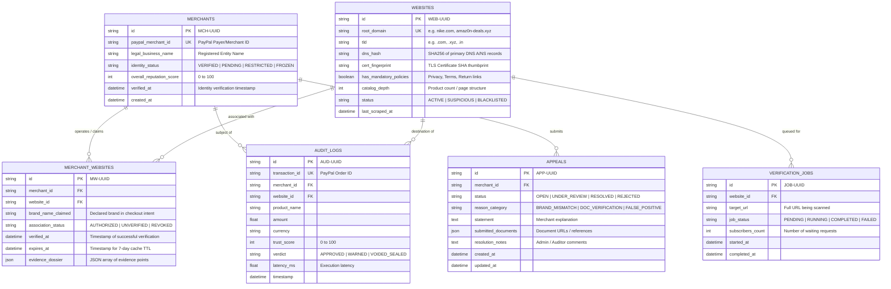

# SYSTEM ARCHITECTURE: ARGUS & SHARED INFRASTRUCTURE

> **Document Status**: Draft / Awaiting User Approval  
> **Target Scope**: Argus Security Engine, Shared Server Infrastructure, and Integration Interfaces.

---

## 1. High-Level Architecture Diagram



---

## 2. Normalized Database Entity-Relationship (ER) Model

To prevent the critical security vulnerabilities discussed during brainstorming (e.g., separating merchant business identity from authorized website domains), the database is organized into normalized relational entities:



---

## 3. Core Subsystem Responsibilities

### 3.1 Argus Security Engine
* **Pre-Flight Gateway**: Listens at `/api/v1/checkout/verify`. Intercepts the checkout payload containing `brand_name`, `merchant_url`, `product_name`, `price`, `currency`.
* **Parallel Forensic Execution (Multi-Threaded / Async)**:
  * *Worker 1 (Domain Forensics)*: Computes Levenshtein distance against verified brand dictionary, checks TLD risk registries, and inspects subdomain nesting.
  * *Worker 2 (Catalog & Policy Inspector)*: Headless DOM inspection to confirm presence of Privacy Policy, Terms of Service, Return/Refund guarantees, and catalog inventory depth (filtering 1-page phishing landing scams).
  * *Worker 3 (Price Anomaly AI)*: Evaluates unit price against category floor benchmarks (e.g. flagship consumer electronics priced 80%+ below retail price triggers high-confidence fraud).
  * *Worker 4 (Evidence Synthesizer & Scoring)*: Computes weighted trust score (0–100), compiles human-readable evidence strings, and determines the mitigation action.

### 3.2 Shared Server & Verification Manager
* **7-Day Conditional Verification Caching**:
  * If a `(merchant_id, website_id)` association exists with `association_status = "AUTHORIZED"` and `now() < expires_at`, the existing trust score is returned instantly (< 2 ms).
  * **The Conditionality Rule**: If change detection flags an alteration (DNS IP shift, TLS cert change, or new fraud complaint), `expires_at` is immediately invalidated, forcing re-verification.
* **Single-Flight Concurrency Coordinator**:
  * Prevents "Thundering Herd" spikes when 1,000 users visit an unverified merchant simultaneously.
  * Checks an in-memory lock registry: `ActiveJobs[website_id]`.
  * If a job is already `RUNNING`, incoming requests attach an asynchronous Future/Promise to that job ID rather than spawning duplicate crawler threads.
  * When the job completes, the result broadcasts to all waiting callers simultaneously.
* **Lightweight Change Detection**:
  * Stores lightweight signatures (`dns_hash`, `cert_fingerprint`).
  * Fast-path requests verify signatures before granting cached reuse.

### 3.3 Merchant Grievance & Appeal System (The "Anti-Dead-End" Principle)
* **The Problem It Solves**: In typical payment networks, automated fraud freezes ban merchants with zero explanation and no effective recourse.
* **Argus Appeal Workflow**:
  1. When a transaction is blocked or a merchant is quarantined, a unique `Incident Reference Number` is returned.
  2. The merchant accesses the Argus Appeal Portal.
  3. The merchant reviews the exact evidence dossier (e.g., *"Brand declared as 'Apple' but domain is 'apple-clearance.shop'"*).
  4. The merchant submits proof of brand authorization or corporate identity.
  5. Status updates transition transparently: `OPEN` $\rightarrow$ `UNDER_REVIEW` $\rightarrow$ `RESOLVED`.
  6. Upon approval, the registry updates `association_status = "AUTHORIZED"`.

---

## 4. Inter-Component Communication & API Contracts

Argus and Accord remain strictly independent. Communication occurs via clean REST API endpoints exposed by Argus/Server:

### 4.1 `POST /api/v1/checkout/verify`
Called by checkout frontends, payment gateways, or Accord before initiating/authorizing PayPal payments.

**Request Payload:**
```json
{
  "client_reference_id": "ACCORD-EXP-1092",
  "paypal_merchant_id": "MCH-882190",
  "brand_name_claimed": "MakeMyTrip",
  "merchant_url": "https://makemytrip.com/hotels/manali-booking",
  "product_name": "Manali Deluxe Hotel (3 Nights)",
  "price": 12000.00,
  "currency": "INR"
}
```

**Response Payload (Cached or Verified):**
```json
{
  "trust_score": 96,
  "risk_level": "LOW",
  "action": "APPROVED_FOR_CAPTURE",
  "merchant_status": "ACTIVE",
  "cache_hit": true,
  "cache_age_days": 1.4,
  "total_latency_ms": 1.8,
  "evidence": [
    "Domain verified: 'makemytrip.com' is officially registered to MakeMyTrip.",
    "Mandatory consumer policies (Refund, Privacy, Terms) verified active.",
    "No price or catalog anomalies detected."
  ],
  "verification_dossier_id": "VD-99214"
}
```

### 4.2 `POST /api/v1/appeals/submit`
Called by merchants to challenge an automated restriction.

**Request Payload:**
```json
{
  "merchant_id": "MCH-882190",
  "incident_reference_id": "SEC-8092",
  "reason_category": "BRAND_MISMATCH",
  "merchant_statement": "We are an authorized reseller operating under Imagine Online Store.",
  "document_urls": ["https://proof.example.com/reseller-agreement.pdf"]
}
```

---

## 5. Security Analysis, Contradictions & Dilemmas

### 5.1 Dilemma 1: "Verified on One Site = Verified on All Sites?" (The Reseller Spoof Attack)
* **The Brainstorming Contradiction**: In Turn 28, the user proposed: *"if a merchant is verified in a site he doesn't need to get verified in other sites similar to weekly limit"*.
* **The Security Flaw**: If Scammer registers a merchant ID on a legitimate, verified site (e.g., selling handmade mugs on `artisan-shop.com`), and then uses that same verified Merchant ID on a phishing clone (`amaz0n-deals.xyz`), trusting the second site simply because the merchant identity was verified creates a catastrophic loophole!
* **Architectural Resolution**: **Decouple Identity from Domain Authorization.**
  * *Merchant Identity Verification* (e.g. KYC, PayPal ID validity) is cached and reusable.
  * *Merchant-to-Domain Association* must **ALWAYS** be verified independently for every distinct root domain!

### 5.2 Dilemma 2: Binary Account Freezing vs. Small Business Destruction
* **The Contradiction**: Immediate hard-freezing of seller accounts upon any anomaly can ruin legitimate emerging businesses who lack brand recognition or rich product catalogs.
* **Architectural Resolution**: Deploy the **3-Tier Risk Hierarchy**:
  * Score 70–100: **ALLOW** (Seamless).
  * Score 45–69: **WARN / HOLD** (Warn buyer; require additional step-up authentication).
  * Score 0–44 with Brand Impersonation: **BLOCK & QUARANTINE** (High-confidence malicious phishing).

### 5.3 Dilemma 3: Cache Poisoning & Time-of-Check to Time-of-Use (TOCTOU)
* **The Flaw**: A scammer creates a benign website, passes the 7-day verification on Day 1, and on Day 3 redirects DNS or swaps the landing page to an aggressive phishing campaign.
* **Architectural Resolution**: **Conditional Fast-Path Verification.**
  * The 7-day cache only releases payment if the current request's DNS resolution and lightweight header hashes match the stored baseline.
  * Any detected shift forces an immediate cache invalidation and kicks off re-verification.

### 5.4 Dilemma 4: Single-Flight Denial of Service
* **The Flaw**: Attackers send 5,000 distinct fake subdomains (`a.scam.xyz`, `b.scam.xyz`) to overwhelm the single-flight queue.
* **Architectural Resolution**: Single-flight concurrency locks must be keyed on **Root Domain** (`scam.xyz`) rather than the raw URL string.

---

## 6. Unresolved Technical Questions for User Alignment

1. **Database Selection**:
   * *Option A*: SQLite with WAL mode (Zero configuration, lightweight, runs natively in local repo for hackathon demo).
   * *Option B*: PostgreSQL / Supabase (Requires external credentials/docker setup).
   * *(Recommendation: Start with SQLite with WAL mode, architected via SQLAlchemy/Pydantic so it can point to PostgreSQL if needed).*

2. **Single-Flight Concurrency Mechanism**:
   * In local single-node deployment, an async in-memory task map (`asyncio.Future` / `threading.Event`) manages single-flight coordination with zero extra dependencies.
   * Do you approve this lightweight in-memory approach, or do you want Redis integrated?

3. **Merchant Appeal Interface in Demo**:
   * Should the appeal flow be an integrated tab on the AG Grid Dashboard (letting you click a frozen merchant, view their appeal ticket, and click "Approve Appeal" to watch the status flip to Green live)?
