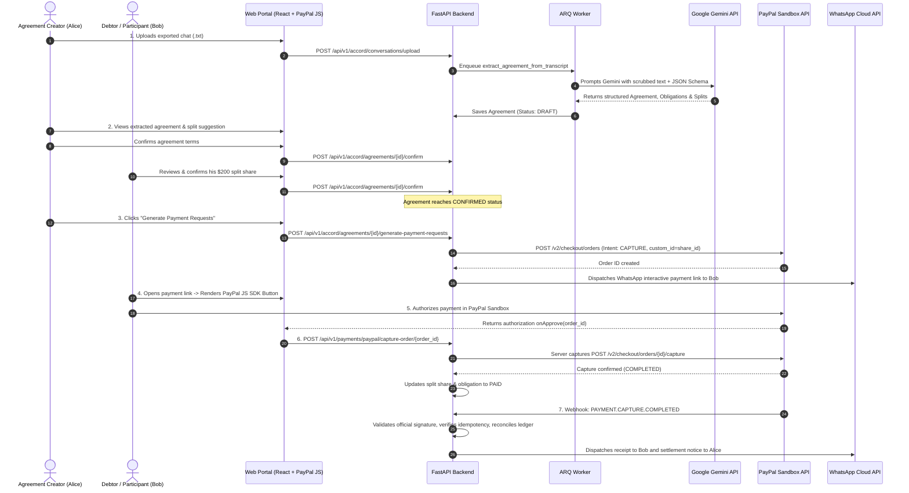

# VERITAS Platform Architecture Specification

## 1. Executive Summary & Vision

**VERITAS** is a unified trust and transactional intelligence platform comprising two complementary products sharing a robust, production-grade foundation:

1. **ACCORD (Conversational Intelligence & Financial Agreements):** Transforms unstructured, user-submitted conversations (e.g., exported WhatsApp chats, transcripts, structured text) into clear, human-reviewed agreements, participant commitments, obligations, expense splits, and actionable PayPal payment requests.
2. **ARGUS (Merchant Identity Verification & Website Security Trust Engine):** Evaluates merchant legitimacy, independently verifies domain ownership, audits external website security posture, computes explainable, evidence-backed risk scores, and provides pre-checkout risk advisories.

Both products share a modular platform: unified authentication (IAM) and role-based access control (RBAC), a single PostgreSQL database with domain-specific schemas, Redis with **ARQ** for asynchronous task execution, an integrated Google Gemini AI adapter, PayPal Sandbox payment infrastructure, and a Meta WhatsApp Cloud API notification gateway.

---

## 2. Core MVP Scope vs. Post-MVP Roadmap

```
┌──────────────────────────────────────────────────────────────────────────────────┐
│                                VERITAS PLATFORM                                  │
├────────────────────────────────────────┬─────────────────────────────────────────┤
│               CORE MVP                 │           POST-MVP (FUTURE)             │
├────────────────────────────────────────┼─────────────────────────────────────────┤
│ • Modular FastAPI monolith             │ • Microservices decomposition           │
│ • Unified IAM & RBAC (JWT + Redis)     │ • Multi-factor authentication (WebAuthn)│
│ • PostgreSQL schemas (core,accord,argus)│ • Automated read replicas               │
│ • ARQ worker with Redis queues         │ • Distributed tracing with OpenTelemetry│
│ • Google Gemini AI provider & adapter  │ • Alternate AI providers (Anthropic,    │
│ • PayPal Sandbox Orders & Invoicing API│   local Ollama models)                  │
│ • Server-side capture & official verify│ • Automated recipient split payouts     │
│ • WhatsApp Cloud API template gateway  │ • Interactive WhatsApp 2-way bot chat   │
├────────────────────────────────────────┼─────────────────────────────────────────┤
│              ACCORD MVP                │            ACCORD POST-MVP              │
├────────────────────────────────────────┼─────────────────────────────────────────┤
│ • Chat export (.txt) & text ingestion  │ • Audio note speech-to-text (Whisper)   │
│ • Gemini agreement & split extraction  │ • Recurring subscription split cycles   │
│ • Ambiguity detection & NL queries     │ • Dispute arbitration resolution portal │
│ • Mandatory human review & approval    │ • Multi-platform chat (Telegram, Slack) │
│ • Decimal-safe expense split engine    │ • Multi-currency automated FX conversion│
│ • Explicit payment request generation  │ • Automated escalation reminder loops   │
│ • Freelance milestone PayPal invoices  │                                         │
├────────────────────────────────────────┼─────────────────────────────────────────┤
│               ARGUS MVP                │             ARGUS POST-MVP              │
├────────────────────────────────────────┼─────────────────────────────────────────┤
│ • Merchant profile registration        │ • Embeddable JavaScript seal (seal.js)  │
│ • Independent per-domain authorization │ • Paid merchant subscription tiers      │
│ • Automated security scanner (SSL,     │ • Advanced KYB government API sync      │
│   headers, DNSSEC, Safe Browsing)      │ • Continuous real-time domain monitor   │
│ • Gemini evidence & risk summarizer    │ • Consumer complaint & review portal    │
│ • Explainable scoring (0-100)          │ • Machine-learning predictive fraud ML  │
│ • Explicit policy (payment_allowed)    │                                         │
│ • Pre-checkout risk assessment API     │                                         │
└────────────────────────────────────────┴─────────────────────────────────────────┘
```

---

## 3. High-Level Architecture Diagram

```mermaid
flowchart TB
    subgraph ClientLayer ["Client & Ingress Layer"]
        ReactApp["VERITAS Web Portal\n(React + Vite + TypeScript + Tailwind)"]
        PayPalSDK["PayPal JavaScript SDK\n(@paypal/react-paypal-js)"]
        ConsentingUser["Consenting WhatsApp User\n(Direct Opt-In & Templates)"]
    end

    subgraph IngressGateway ["Gateway & Reverse Proxy"]
        ReverseProxy["Nginx / Caddy\n(TLS Termination, Rate Limiting, WAF)"]
    end

    subgraph BackendApp ["FastAPI Application (Modular Monolith)"]
        direction TB
        
        subgraph CorePlatform ["Shared Core Platform Services"]
            AuthModule["IAM & RBAC Service\n(JWT, Refresh Tokens, Password Hashing)"]
            AIAdapter["Provider-Independent AI Service\n(Google Gemini API Adapter + Pydantic v2)"]
            PaymentGateway["PayPal Payment Broker\n(OAuth2, Orders API, Invoicing, Capture, Webhooks)"]
            MsgGateway["WhatsApp Gateway\n(Opt-in Verification & Template Dispatcher)"]
            AuditService["Immutable Audit & Compliance Logger"]
            ARQBroker["ARQ Job Queue & Scheduler\n(Redis Connection Pool & Retry Policy)"]
        end

        subgraph ACCORDDomain ["ACCORD Subsystem (Conversational Intelligence)"]
            TranscriptIngestion["Transcript Ingestion & Sanitizer\n(Exported Text, PII Redaction)"]
            NlpExtractor["Extraction & Ambiguity Engine\n(Agreements, Obligations, Splits via Gemini)"]
            AgreementStateMachine["Lifecycle & Human Confirmation\n(Draft -> Review -> Confirmed)"]
            SplitEngine["Decimal-Safe Expense Splitter\n(Equal, Exact, %, Shares)"]
            AccordPay["Payment Request Dispatcher\n(Explicit User Trigger Only)"]
        end

        subgraph ARGUSDomain ["ARGUS Subsystem (Merchant Trust & Security)"]
            MerchantMgmt["Merchant Profile Manager"]
            DomainAuth["Independent Domain Authorization\n(DNS TXT & Meta-Tag Challenges)"]
            SecurityScanner["Non-Invasive Security Scanner\n(SSL/TLS, Headers, DNSSEC, SafeBrowsing)"]
            TrustEngine["Explainable Risk Scorer\n(trust_score 0-100, risk_level, payment_allowed)"]
            EvidenceExplainer["Evidence & Risk Summarizer\n(Gemini Narrative Generator)"]
            RiskAdvisory["Pre-Checkout Risk Advisory API"]
        end
    end

    subgraph PersistenceLayer ["Persistence & Cache Layer"]
        PostgresDB[(PostgreSQL 16\nSchemas: core, accord, argus)]
        RedisCache[(Redis 7\nARQ Queues, Cache, Revocation, Rate Limits)]
    end

    subgraph ExternalServices ["External Cloud Services"]
        GeminiAPI["Google Gemini API\n(gemini-1.5-flash / gemini-2.0-flash)"]
        PayPalAPI["PayPal Sandbox REST API\n(v2 Orders, Invoicing, Official Webhook Verify)"]
        WhatsAppAPI["Meta WhatsApp Cloud API\n(Graph API v19+ Templates)"]
        ThreatFeeds["Public Threat Feeds & DNS\n(Google Safe Browsing, DNSSEC, WHOIS)"]
    end

    %% Client Layer
    ReactApp --> PayPalSDK
    ReactApp -->|REST / HTTPS| ReverseProxy
    ConsentingUser <-->|Opt-In WhatsApp Notifications| WhatsAppAPI

    %% Gateway to backend
    ReverseProxy --> BackendApp

    %% Backend to persistence
    BackendApp --> PostgresDB
    BackendApp --> RedisCache
    ARQBroker <--> RedisCache

    %% External APIs
    AIAdapter <-->|Structured JSON Generation| GeminiAPI
    PaymentGateway <-->|Verify Webhook & Server Capture| PayPalAPI
    MsgGateway -->|Send Outbound Pre-approved Templates| WhatsAppAPI
    SecurityScanner -->|DNS, TLS Handshake, Reputation| ThreatFeeds

    %% Cross-domain interface
    AccordPay -.->|Optional Risk Query via Interface| RiskAdvisory
```



---

## 4. Artificial Intelligence Subsystem (Google Gemini API)

Google Gemini API is the **mandatory initial AI provider** for VERITAS, integrated via a provider-independent service adapter.

### 4.1 Architecture of the AI Service Adapter
```
backend/app/core/ai/
├── base.py             # Abstract BaseAIProvider interface
├── gemini_adapter.py   # Concrete Google Gemini API implementation
├── schemas.py          # Structured Pydantic v2 extraction schemas
└── factory.py          # Factory creating the configured provider
```

### 4.2 Core AI Responsibilities
1. **ACCORD Capabilities:**
   - **Conversation Understanding:** Ingesting multi-turn conversation transcripts and mapping interlocutor aliases to participant identities.
   - **Agreement & Obligation Extraction:** Synthesizing terms, deliverables, due dates, currencies, and amounts into strictly validated Pydantic models.
   - **Expense Split Suggestions:** Proposing mathematical split distributions based on natural language cues.
   - **Ambiguity Detection:** Identifying missing details, vague amounts, conflicting dates, or unassigned debts, prompting users with targeted clarification warnings.
   - **Natural-Language Financial Queries:** Answering conversational queries (e.g., *"How much did Charlie owe for lodging after Alice covered groceries?"*).
2. **ARGUS Capabilities:**
   - **Evidence & Risk Summarization:** Translating raw scanner JSON (cipher suites, missing headers, DNSSEC status) into plain-English executive summaries and actionable remediation steps.

### 4.3 Strict Safety & Authorization Boundary
> [!IMPORTANT]
> **Deterministic Control Principle:** LLM outputs must **never** independently authorize payments, execute fund captures, modify financial ledgers, or make final security policy decisions.
> - In ACCORD: Gemini generates *unconfirmed proposals* (`status = 'DRAFT'`). Actionable financial transactions require explicit human confirmation.
> - In ARGUS: Gemini summarizes evidence. The `payment_allowed` decision and `trust_score` are governed by deterministic, transparent policy rules.

---

## 5. Background Job Processing (ARQ with Redis)

All asynchronous, long-running, or I/O-intensive workloads run on **ARQ**, a lightweight, high-performance async job queue built natively for Python `asyncio` and Redis.

### 5.1 Worker Architecture & Configuration
- **Broker:** Redis 7 connection pool shared with FastAPI.
- **Job Definitions:**
  - `run_website_security_scan(domain_id: str)`
  - `extract_agreement_from_transcript(conversation_id: str)`
  - `verify_merchant_domain_dns(domain_id: str)`
  - `send_whatsapp_template_notification(notification_id: str)`
  - `purge_expired_transcripts()`
- **Retry Policy & Exponential Backoff:**
  - Default: Max 3 retries with exponential backoff:
    $$\Delta t = \min(2^{\text{job\_try}} \cdot 5\text{s} + \text{jitter}, 60\text{s})$$
- **Timeouts:**
  - AI extraction tasks: $45\text{ seconds}$ execution timeout.
  - Security scanning tasks: $60\text{ seconds}$ execution timeout.
  - Notification dispatch: $15\text{ seconds}$ execution timeout.
- **Idempotency:** Jobs are enqueued with unique keys (`job_id = f"{job_type}:{resource_id}:{version}"`) to prevent duplicate execution.
- **Failure & Dead-Letter Handling (Custom Design):** ARQ does not provide a native Dead Letter Queue (DLQ). VERITAS implements an explicit custom failure recording mechanism: when a job exhausts all retries (`job_try >= max_tries`), the worker's `on_job_end` lifecycle hook intercepts the failure. It serializes the job arguments, attempt history, and exception traceback into a dedicated Redis dead-letter stream (`veritas:arq:dead_letter_queue`), logs an immutable entry in `core.audit_logs`, and marks the underlying domain resource (`parsing_status` in `accord.conversations`, `scan_status` in `argus.website_scans`, or `status` in `core.notifications`) as `FAILED` with actionable diagnostic details.

---

## 6. PayPal Developer Platform Integration

PayPal is mandatory in the MVP and deeply integrated across the platform:

### 6.1 Authentication & Credential Architecture
- **Environment:** PayPal Sandbox (`https://api-m.sandbox.paypal.com`).
- **Authentication:** OAuth2 client credentials grant caching access tokens in Redis with dynamic expiry ($TTL = \text{expires\_in} - 120\text{s}$).

### 6.2 Payment Order Lifecycle & Server-Side Capture
1. **Order Creation:** Backend invokes PayPal Orders API (`POST /v2/checkout/orders`) with:
   - `intent: "CAPTURE"`
   - `custom_id`: Bound to `accord.split_shares.id`
   - Explicit line items, amounts, and currency.
2. **Frontend Approval:** Frontend embeds the official PayPal JavaScript SDK (`@paypal/react-paypal-js`). The debtor approves the transaction in the PayPal Sandbox modal.
3. **Mandatory Server-Side Capture:** The frontend passes the approved `order_id` back to the VERITAS backend. The backend calls `POST /v2/checkout/orders/{order_id}/capture`, strictly verifies that the captured amount and currency match the specific individual `accord.payment_requests` record and its associated debtor `obligation` (not the overall group agreement total), and commits the settlement.

### 6.3 Payout Model & Sandbox Realities
- **MVP Payment Collection:** For MVP, all transactions are processed through a configured Sandbox merchant receiver account.
- **Recipient Payouts Separation:** Ordinary PayPal Checkout does not support arbitrary automated peer-to-peer split payouts. Recipient payouts to creditors are maintained as a separate settlement ledger, preparing for PayPal Payouts API once sandbox recipient onboarding is completed.

### 6.4 PayPal Invoicing API
- For freelance agreements with milestone deliverables, ACCORD integrates PayPal's Invoicing API (`POST /v2/invoicing/invoices`), generating formal draft/sent invoices with due dates, line items, and Sandbox payment links.

---

## 7. ARGUS Trust Scoring & Risk Assessment Specification

### 7.1 Score & Risk Level Definitions
- **`trust_score`:** Continuous integer/float value from **$0$ to $100$**, where higher denotes greater technical hygiene and proven authenticity.
- **`risk_level`:** Exactly one of four discrete categories:
  - `LOW` ($80 - 100\text{ pts}$): Excellent security posture, verified domain, clean standing.
  - `MEDIUM` ($50 - 79\text{ pts}$): Minor configuration gaps (e.g., missing CSP), but verified and clean.
  - `HIGH` ($25 - 49\text{ pts}$): Significant vulnerabilities (e.g., weak TLS, missing DNS records) or unverified domain.
  - `CRITICAL` ($0 - 24\text{ pts}$): Severe threats, active malware detection, or failed ownership verification.
- **`payment_allowed`:** A separate, deterministic policy boolean. For example:
  - `payment_allowed = False` if `risk_level == CRITICAL` OR domain ownership is unverified.
- **Non-Negotiable Policy:**
  > [!WARNING]
  > **TLS alone is NEVER proof of merchant legitimacy.** Free automated TLS certificates (e.g. Let's Encrypt) are easily obtained by phishing sites. High trust scores strictly require independent domain authorization, security headers, clean reputation feeds, and valid DNS authentication (SPF/DMARC).

---

## 8. End-to-End Working MVP Demonstration Workflow

The primary end-to-end user journey demonstrates the complete convergence of ACCORD, Google Gemini, ARQ, PayPal Sandbox, and WhatsApp Cloud API:


