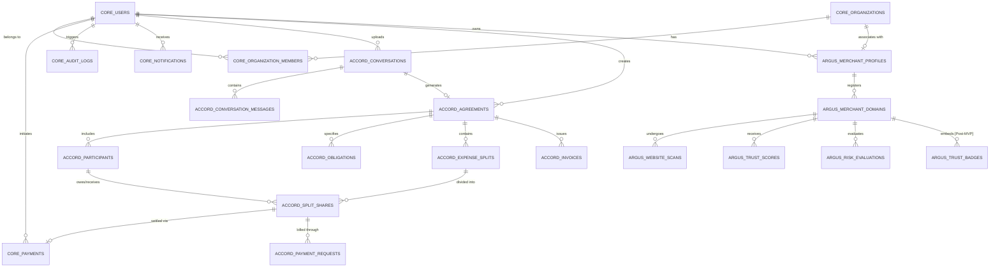

# VERITAS Database Schema & Data Modeling Specification

## 1. Overview & Schema Architecture

VERITAS uses **PostgreSQL 16+** with **SQLAlchemy 2.0 (asyncio)** and **Alembic**.

The database enforces domain isolation across three PostgreSQL schemas:
1. `core`: Shared identity, organizations, global payment records (PayPal Orders & Invoices), notifications, idempotent webhook tracking, and immutable audit logs.
2. `accord`: Raw/scrubbed conversation transcripts, AI-extracted agreements and ambiguity flags, participant lists, obligations, expense splits, and payment/invoice requests.
3. `argus`: Merchant profiles, independent per-domain ownership challenges, automated security scan records, explainable risk assessments with explicit `payment_allowed` policy flags, and pre-checkout advisories.

---

## 2. Entity-Relationship (ER) Diagram

---

## 3. Core Schema Tables (`core`)

### 3.1 `core.users`
| Column | Type | Constraints | Description |
| :--- | :--- | :--- | :--- |
| `id` | `UUID` | `PRIMARY KEY, DEFAULT gen_random_uuid()` | Unique user identifier |
| `email` | `VARCHAR(255)` | `UNIQUE, NOT NULL, INDEX` | Login email address |
| `phone_number` | `VARCHAR(32)` | `UNIQUE, INDEX` | E.164 format phone number |
| `password_hash` | `VARCHAR(255)` | `NOT NULL` | Argon2id password hash |
| `full_name` | `VARCHAR(150)` | `NOT NULL` | User full name |
| `role` | `VARCHAR(32)` | `NOT NULL, DEFAULT 'USER'` | `SUPER_ADMIN`, `MERCHANT_ADMIN`, `USER`, `AUDITOR` |
| `whatsapp_opt_in` | `BOOLEAN` | `NOT NULL, DEFAULT false` | Explicit user consent for WhatsApp notifications |
| `whatsapp_opt_in_at` | `TIMESTAMPTZ` | `NULLABLE` | Timestamp of explicit WhatsApp consent |
| `is_active` | `BOOLEAN` | `NOT NULL, DEFAULT true` | Active account status |
| `is_verified` | `BOOLEAN` | `NOT NULL, DEFAULT false` | Email verification flag |
| `created_at` | `TIMESTAMPTZ` | `NOT NULL, DEFAULT NOW()` | Account creation timestamp |
| `updated_at` | `TIMESTAMPTZ` | `NOT NULL, DEFAULT NOW()` | Last update timestamp |

### 3.2 `core.organizations`
| Column | Type | Constraints | Description |
| :--- | :--- | :--- | :--- |
| `id` | `UUID` | `PRIMARY KEY, DEFAULT gen_random_uuid()` | Organization identifier |
| `name` | `VARCHAR(200)` | `NOT NULL` | Organization name |
| `slug` | `VARCHAR(100)` | `UNIQUE, NOT NULL, INDEX` | URL slug |
| `owner_id` | `UUID` | `NOT NULL, FK -> core.users(id)` | Organization owner |
| `created_at` | `TIMESTAMPTZ` | `NOT NULL, DEFAULT NOW()` | Creation timestamp |
| `updated_at` | `TIMESTAMPTZ` | `NOT NULL, DEFAULT NOW()` | Update timestamp |

### 3.3 `core.organization_members`
| Column | Type | Constraints | Description |
| :--- | :--- | :--- | :--- |
| `id` | `UUID` | `PRIMARY KEY, DEFAULT gen_random_uuid()` | Membership ID |
| `organization_id` | `UUID` | `NOT NULL, FK -> core.organizations(id)` | Organization reference |
| `user_id` | `UUID` | `NOT NULL, FK -> core.users(id)` | User reference |
| `role` | `VARCHAR(32)` | `NOT NULL, DEFAULT 'MEMBER'` | `OWNER`, `ADMIN`, `MEMBER`, `BILLING` |
| `created_at` | `TIMESTAMPTZ` | `NOT NULL, DEFAULT NOW()` | Join timestamp |

### 3.4 `core.payments`
Central financial ledger integrating PayPal Sandbox Orders and Invoicing APIs.

| Column | Type | Constraints | Description |
| :--- | :--- | :--- | :--- |
| `id` | `UUID` | `PRIMARY KEY, DEFAULT gen_random_uuid()` | Internal payment ID |
| `user_id` | `UUID` | `FK -> core.users(id), INDEX` | User responsible / payer |
| `amount` | `NUMERIC(14, 4)` | `NOT NULL` | Exact transaction value |
| `currency` | `VARCHAR(3)` | `NOT NULL, DEFAULT 'USD'` | ISO 4217 currency code |
| `provider` | `VARCHAR(32)` | `NOT NULL, DEFAULT 'PAYPAL'` | Provider (`PAYPAL`) |
| `payment_type` | `VARCHAR(32)` | `NOT NULL, DEFAULT 'CHECKOUT_ORDER'`| `CHECKOUT_ORDER`, `INVOICE` |
| `provider_order_id`| `VARCHAR(128)` | `INDEX, NULLABLE` | PayPal Order ID (`ORDERS-V2`) |
| `provider_capture_id`| `VARCHAR(128)` | `INDEX, NULLABLE` | Server-side captured ID |
| `provider_invoice_id`| `VARCHAR(128)` | `INDEX, NULLABLE` | PayPal Invoicing ID (`INV2-...`) |
| `receiver_merchant_account`| `VARCHAR(255)` | `NOT NULL` | Configured Sandbox receiver account |
| `status` | `VARCHAR(32)` | `NOT NULL, DEFAULT 'CREATED'` | `CREATED`, `APPROVED`, `CAPTURED`, `FAILED`, `REFUNDED` |
| `idempotency_key` | `VARCHAR(128)` | `UNIQUE, NOT NULL, INDEX` | Unique idempotency key |
| `payer_email` | `VARCHAR(255)` | `NULLABLE` | Payer's verified PayPal email |
| `metadata` | `JSONB` | `DEFAULT '{}'::jsonb` | Context (e.g., `{"split_share_id": "..."}`) |
| `created_at` | `TIMESTAMPTZ` | `NOT NULL, DEFAULT NOW()` | Creation timestamp |
| `captured_at` | `TIMESTAMPTZ` | `NULLABLE` | Server-side capture timestamp |

### 3.5 `core.notifications`
| Column | Type | Constraints | Description |
| :--- | :--- | :--- | :--- |
| `id` | `UUID` | `PRIMARY KEY, DEFAULT gen_random_uuid()` | Notification ID |
| `user_id` | `UUID` | `FK -> core.users(id), NULLABLE` | Target registered user |
| `recipient_phone` | `VARCHAR(32)` | `NOT NULL, INDEX` | Recipient E.164 phone number |
| `channel` | `VARCHAR(20)` | `NOT NULL, DEFAULT 'WHATSAPP'` | `WHATSAPP`, `EMAIL`, `IN_APP` |
| `template_name` | `VARCHAR(64)` | `NOT NULL` | Meta pre-approved template name |
| `payload` | `JSONB` | `NOT NULL` | Template parameter values |
| `status` | `VARCHAR(20)` | `NOT NULL, DEFAULT 'QUEUED'` | `QUEUED`, `SENT`, `DELIVERED`, `READ`, `FAILED` |
| `opt_in_verified`| `BOOLEAN` | `NOT NULL, DEFAULT false` | Confirms recipient opt-in existed |
| `error_message` | `TEXT` | `NULLABLE` | Delivery failure error details |
| `sent_at` | `TIMESTAMPTZ` | `NULLABLE` | Dispatch timestamp |
| `created_at` | `TIMESTAMPTZ` | `NOT NULL, DEFAULT NOW()` | Creation timestamp |

### 3.6 `core.webhook_events`
| Column | Type | Constraints | Description |
| :--- | :--- | :--- | :--- |
| `id` | `UUID` | `PRIMARY KEY, DEFAULT gen_random_uuid()` | Event ID |
| `provider` | `VARCHAR(32)` | `NOT NULL` | `PAYPAL`, `WHATSAPP` |
| `event_id` | `VARCHAR(128)` | `NOT NULL` | External provider event ID |
| `event_type` | `VARCHAR(100)` | `NOT NULL` | E.g. `PAYMENT.CAPTURE.COMPLETED` |
| `event_timestamp`| `TIMESTAMPTZ` | `NOT NULL` | Provider event timestamp |
| `payload` | `JSONB` | `NOT NULL` | Complete raw JSON payload |
| `status` | `VARCHAR(20)` | `NOT NULL, DEFAULT 'RECEIVED'` | `RECEIVED`, `PROCESSING`, `PROCESSED`, `FAILED`, `DUPLICATE_IGNORED` |
| `processing_error`| `TEXT` | `NULLABLE` | Stack trace if processing failed |
| `received_at` | `TIMESTAMPTZ` | `NOT NULL, DEFAULT NOW()` | Server receipt timestamp |
| `processed_at` | `TIMESTAMPTZ` | `NULLABLE` | Processing completion timestamp |

*Constraint: `UNIQUE (provider, event_id)`*

### 3.7 `core.audit_logs`
| Column | Type | Constraints | Description |
| :--- | :--- | :--- | :--- |
| `id` | `UUID` | `PRIMARY KEY, DEFAULT gen_random_uuid()` | Log ID |
| `user_id` | `UUID` | `FK -> core.users(id), NULLABLE` | Actor executing action |
| `action` | `VARCHAR(100)` | `NOT NULL` | Action identifier |
| `resource_type` | `VARCHAR(50)` | `NOT NULL` | Resource category |
| `resource_id` | `VARCHAR(64)` | `NOT NULL` | Target resource ID |
| `ip_address` | `VARCHAR(45)` | `NULLABLE` | Client IP address |
| `changes` | `JSONB` | `DEFAULT '{}'::jsonb` | Diff of modified state |
| `created_at` | `TIMESTAMPTZ` | `NOT NULL, DEFAULT NOW()` | Event timestamp |

---

## 4. ACCORD Schema Tables (`accord`)

### 4.1 `accord.conversations`
| Column | Type | Constraints | Description |
| :--- | :--- | :--- | :--- |
| `id` | `UUID` | `PRIMARY KEY, DEFAULT gen_random_uuid()` | Conversation ID |
| `creator_id` | `UUID` | `NOT NULL, FK -> core.users(id)` | User who explicitly uploaded transcript |
| `title` | `VARCHAR(200)` | `NOT NULL` | Descriptive title |
| `source_type` | `VARCHAR(32)` | `NOT NULL, DEFAULT 'EXPORT_TXT'`| `EXPORT_TXT`, `MANUAL_PASTE` |
| `raw_transcript` | `TEXT` | `NOT NULL` | Original text (retained per retention policy) |
| `scrubbed_transcript`| `TEXT` | `NULLABLE` | PII-sanitized text sent to Gemini |
| `is_pii_scrubbed`| `BOOLEAN` | `NOT NULL, DEFAULT false` | Scrubbing status |
| `ai_model_used` | `VARCHAR(64)` | `NOT NULL, DEFAULT 'gemini-1.5-flash'`| Gemini model version |
| `ambiguity_warnings`| `JSONB` | `DEFAULT '[]'::jsonb` | AI-detected ambiguities or missing terms |
| `parsing_status` | `VARCHAR(20)` | `NOT NULL, DEFAULT 'PENDING'` | `PENDING`, `PARSING`, `COMPLETED`, `FAILED` |
| `retention_until`| `TIMESTAMPTZ` | `NOT NULL` | Expiry date for raw transcript purge |
| `deleted_at` | `TIMESTAMPTZ` | `NULLABLE` | Soft-delete timestamp upon user deletion |
| `created_at` | `TIMESTAMPTZ` | `NOT NULL, DEFAULT NOW()` | Upload timestamp |

### 4.2 `accord.conversation_messages`
| Column | Type | Constraints | Description |
| :--- | :--- | :--- | :--- |
| `id` | `UUID` | `PRIMARY KEY, DEFAULT gen_random_uuid()` | Message ID |
| `conversation_id` | `UUID` | `NOT NULL, FK -> accord.conversations(id)` | Parent conversation |
| `sender_name` | `VARCHAR(150)` | `NOT NULL` | Author extracted from transcript |
| `sender_phone` | `VARCHAR(32)` | `NULLABLE` | Phone number if present |
| `message_text` | `TEXT` | `NOT NULL` | Message body |
| `sent_at` | `TIMESTAMPTZ` | `NOT NULL` | Message timestamp from transcript |
| `order_index` | `INT` | `NOT NULL` | Chronological order |

### 4.3 `accord.agreements`
| Column | Type | Constraints | Description |
| :--- | :--- | :--- | :--- |
| `id` | `UUID` | `PRIMARY KEY, DEFAULT gen_random_uuid()` | Agreement identifier |
| `conversation_id` | `UUID` | `FK -> accord.conversations(id), NULLABLE` | Source conversation |
| `creator_id` | `UUID` | `NOT NULL, FK -> core.users(id)` | Creator / Host user |
| `title` | `VARCHAR(255)` | `NOT NULL` | Agreement title |
| `summary` | `TEXT` | `NOT NULL` | Gemini-generated summary |
| `terms` | `JSONB` | `NOT NULL, DEFAULT '[]'::jsonb` | Itemized agreement terms |
| `ambiguity_flags`| `JSONB` | `NOT NULL, DEFAULT '[]'::jsonb` | Detected ambiguities requiring user clarification |
| `total_value` | `NUMERIC(14, 4)` | `NOT NULL, DEFAULT 0.0000` | Aggregated monetary value |
| `currency` | `VARCHAR(3)` | `NOT NULL, DEFAULT 'USD'` | Currency code |
| `status` | `VARCHAR(32)` | `NOT NULL, DEFAULT 'DRAFT'` | `DRAFT`, `PENDING_APPROVAL`, `CONFIRMED`, `SETTLED`, `CANCELLED` |
| `is_confirmed` | `BOOLEAN` | `NOT NULL, DEFAULT false` | Confirmation flag |
| `confirmed_at` | `TIMESTAMPTZ` | `NULLABLE` | Timestamp of confirmation |
| `created_at` | `TIMESTAMPTZ` | `NOT NULL, DEFAULT NOW()` | Creation timestamp |
| `updated_at` | `TIMESTAMPTZ` | `NOT NULL, DEFAULT NOW()` | Update timestamp |

### 4.4 `accord.agreement_participants`
| Column | Type | Constraints | Description |
| :--- | :--- | :--- | :--- |
| `id` | `UUID` | `PRIMARY KEY, DEFAULT gen_random_uuid()` | Participant ID |
| `agreement_id` | `UUID` | `NOT NULL, FK -> accord.agreements(id)` | Associated agreement |
| `user_id` | `UUID` | `FK -> core.users(id), NULLABLE` | Registered account ID |
| `name` | `VARCHAR(150)` | `NOT NULL` | Display name |
| `phone_number` | `VARCHAR(32)` | `NOT NULL, INDEX` | Phone number for contact |
| `role` | `VARCHAR(32)` | `NOT NULL, DEFAULT 'PARTICIPANT'` | `CREATOR`, `PAYER`, `BENEFICIARY`, `WITNESS` |
| `confirmation_status`| `VARCHAR(20)` | `NOT NULL, DEFAULT 'PENDING'` | `PENDING`, `CONFIRMED`, `REJECTED` |
| `confirmed_at` | `TIMESTAMPTZ` | `NULLABLE` | Timestamp of user confirmation |
| `rejection_notes`| `TEXT` | `NULLABLE` | Reason if rejected |

### 4.5 `accord.obligations`
| Column | Type | Constraints | Description |
| :--- | :--- | :--- | :--- |
| `id` | `UUID` | `PRIMARY KEY, DEFAULT gen_random_uuid()` | Obligation ID |
| `agreement_id` | `UUID` | `NOT NULL, FK -> accord.agreements(id)` | Target agreement |
| `debtor_participant_id`| `UUID` | `NOT NULL, FK -> accord.agreement_participants(id)` | Debtor party |
| `creditor_participant_id`| `UUID` | `NULLABLE, FK -> accord.agreement_participants(id)`| Beneficiary party |
| `title` | `VARCHAR(255)` | `NOT NULL` | Obligation title |
| `amount` | `NUMERIC(14, 4)` | `NOT NULL, DEFAULT 0.0000` | Monetary value |
| `currency` | `VARCHAR(3)` | `NOT NULL, DEFAULT 'USD'` | Currency |
| `due_date` | `TIMESTAMPTZ` | `NULLABLE` | Deadline |
| `status` | `VARCHAR(32)` | `NOT NULL, DEFAULT 'PENDING'` | `PENDING`, `FULFILLED`, `OVERDUE`, `WAIVED` |
| `created_at` | `TIMESTAMPTZ` | `NOT NULL, DEFAULT NOW()` | Creation timestamp |

### 4.6 `accord.expense_splits`
| Column | Type | Constraints | Description |
| :--- | :--- | :--- | :--- |
| `id` | `UUID` | `PRIMARY KEY, DEFAULT gen_random_uuid()` | Split identifier |
| `agreement_id` | `UUID` | `NOT NULL, FK -> accord.agreements(id)` | Parent agreement |
| `title` | `VARCHAR(200)` | `NOT NULL` | Expense description |
| `total_amount` | `NUMERIC(14, 4)` | `NOT NULL` | Total expense amount |
| `currency` | `VARCHAR(3)` | `NOT NULL, DEFAULT 'USD'` | Currency |
| `split_method` | `VARCHAR(20)` | `NOT NULL, DEFAULT 'EQUAL'` | `EQUAL`, `EXACT_AMOUNT`, `PERCENTAGE`, `SHARES` |
| `payer_participant_id` | `UUID` | `NOT NULL, FK -> accord.agreement_participants(id)` | Participant who initially fronted payment |
| `status` | `VARCHAR(20)` | `NOT NULL, DEFAULT 'ACTIVE'` | `ACTIVE`, `PARTIALLY_SETTLED`, `SETTLED` |
| `created_at` | `TIMESTAMPTZ` | `NOT NULL, DEFAULT NOW()` | Creation timestamp |

### 4.7 `accord.split_shares`
| Column | Type | Constraints | Description |
| :--- | :--- | :--- | :--- |
| `id` | `UUID` | `PRIMARY KEY, DEFAULT gen_random_uuid()` | Share ID |
| `expense_split_id` | `UUID` | `NOT NULL, FK -> accord.expense_splits(id)` | Parent expense split |
| `participant_id` | `UUID` | `NOT NULL, FK -> accord.agreement_participants(id)` | Debtor participant |
| `share_value` | `NUMERIC(10, 4)` | `NOT NULL` | Weight / Ratio |
| `computed_amount` | `NUMERIC(14, 4)` | `NOT NULL` | Decimal-safe amount owed |
| `settled_amount` | `NUMERIC(14, 4)` | `NOT NULL, DEFAULT 0.0000` | Settled amount |
| `status` | `VARCHAR(20)` | `NOT NULL, DEFAULT 'UNPAID'` | `UNPAID`, `PAID` |
| `payment_id` | `UUID` | `FK -> core.payments(id), NULLABLE` | Linked payment upon capture |

### 4.8 `accord.payment_requests`
| Column | Type | Constraints | Description |
| :--- | :--- | :--- | :--- |
| `id` | `UUID` | `PRIMARY KEY, DEFAULT gen_random_uuid()` | Request ID |
| `agreement_id` | `UUID` | `NOT NULL, FK -> accord.agreements(id)` | Parent agreement |
| `split_share_id` | `UUID` | `NOT NULL, FK -> accord.split_shares(id)` | Split share |
| `generated_by_user_id`| `UUID` | `NOT NULL, FK -> core.users(id)` | User who explicitly authorized generation |
| `payer_phone` | `VARCHAR(32)` | `NOT NULL` | Debtor phone number |
| `paypal_order_id`| `VARCHAR(128)` | `INDEX, NOT NULL` | PayPal order identifier |
| `payment_link_url`| `VARCHAR(512)` | `NOT NULL` | PayPal approval URL |
| `amount` | `NUMERIC(14, 4)` | `NOT NULL` | Owed amount |
| `currency` | `VARCHAR(3)` | `NOT NULL, DEFAULT 'USD'` | Currency |
| `status` | `VARCHAR(20)` | `NOT NULL, DEFAULT 'ACTIVE'` | `ACTIVE`, `CAPTURED`, `EXPIRED`, `CANCELLED` |
| `expires_at` | `TIMESTAMPTZ` | `NOT NULL` | Expiration timestamp |
| `created_at` | `TIMESTAMPTZ` | `NOT NULL, DEFAULT NOW()` | Creation timestamp |

### 4.9 `accord.invoices`
Formal invoices for freelance milestones generated via the PayPal Invoicing API.

| Column | Type | Constraints | Description |
| :--- | :--- | :--- | :--- |
| `id` | `UUID` | `PRIMARY KEY, DEFAULT gen_random_uuid()` | Internal invoice ID |
| `agreement_id` | `UUID` | `NOT NULL, FK -> accord.agreements(id)` | Parent agreement |
| `creator_id` | `UUID` | `NOT NULL, FK -> core.users(id)` | User issuing invoice |
| `recipient_email`| `VARCHAR(255)` | `NOT NULL` | Recipient billing email |
| `paypal_invoice_id`| `VARCHAR(128)` | `UNIQUE, NOT NULL, INDEX` | PayPal invoice identifier (`INV2-...`) |
| `invoice_number` | `VARCHAR(64)` | `NOT NULL` | Sequential invoice number |
| `amount` | `NUMERIC(14, 4)` | `NOT NULL` | Total invoiced amount |
| `currency` | `VARCHAR(3)` | `NOT NULL, DEFAULT 'USD'` | Currency |
| `status` | `VARCHAR(32)` | `NOT NULL, DEFAULT 'DRAFT'` | `DRAFT`, `SENT`, `PAID`, `CANCELLED` |
| `due_date` | `TIMESTAMPTZ` | `NOT NULL` | Payment due date |
| `invoice_url` | `VARCHAR(512)` | `NULLABLE` | Direct PayPal invoice payment URL |
| `created_at` | `TIMESTAMPTZ` | `NOT NULL, DEFAULT NOW()` | Creation timestamp |

---

## 5. ARGUS Schema Tables (`argus`)

### 5.1 `argus.merchant_profiles`
| Column | Type | Constraints | Description |
| :--- | :--- | :--- | :--- |
| `id` | `UUID` | `PRIMARY KEY, DEFAULT gen_random_uuid()` | Merchant identifier |
| `user_id` | `UUID` | `NOT NULL, FK -> core.users(id)` | Merchant owner user account |
| `organization_id` | `UUID` | `FK -> core.organizations(id), NULLABLE` | Associated organization |
| `business_name` | `VARCHAR(255)` | `NOT NULL` | Registered business name |
| `business_registration_no` | `VARCHAR(100)` | `NULLABLE` | State registration number |
| `tax_identifier` | `VARCHAR(100)` | `NULLABLE` | Tax ID / EIN (Encrypted at rest) |
| `country_code` | `VARCHAR(3)` | `NOT NULL, DEFAULT 'USA'` | ISO country code |
| `verification_status` | `VARCHAR(32)` | `NOT NULL, DEFAULT 'PENDING'` | `PENDING`, `ACTIVE`, `SUSPENDED` |
| `created_at` | `TIMESTAMPTZ` | `NOT NULL, DEFAULT NOW()` | Registration date |
| `updated_at` | `TIMESTAMPTZ` | `NOT NULL, DEFAULT NOW()` | Last update date |

### 5.2 `argus.merchant_domains`
| Column | Type | Constraints | Description |
| :--- | :--- | :--- | :--- |
| `id` | `UUID` | `PRIMARY KEY, DEFAULT gen_random_uuid()` | Domain record ID |
| `merchant_id` | `UUID` | `NOT NULL, FK -> argus.merchant_profiles(id)` | Merchant owner |
| `domain_name` | `VARCHAR(255)` | `NOT NULL, INDEX` | Fully qualified domain |
| `challenge_type` | `VARCHAR(32)` | `NOT NULL, DEFAULT 'DNS_TXT'` | `DNS_TXT`, `HTTPS_META_TAG` |
| `challenge_token`| `VARCHAR(128)` | `NOT NULL` | Cryptographic challenge string |
| `authorization_status`| `VARCHAR(32)` | `NOT NULL, DEFAULT 'PENDING'` | `PENDING`, `VERIFIED`, `FAILED`, `REVOKED` |
| `verified_at` | `TIMESTAMPTZ` | `NULLABLE` | Verification timestamp |
| `created_at` | `TIMESTAMPTZ` | `NOT NULL, DEFAULT NOW()` | Registration timestamp |
| `updated_at` | `TIMESTAMPTZ` | `NOT NULL, DEFAULT NOW()` | Status change timestamp |

*Constraint: `UNIQUE (merchant_id, domain_name)`*

### 5.3 `argus.website_scans`
| Column | Type | Constraints | Description |
| :--- | :--- | :--- | :--- |
| `id` | `UUID` | `PRIMARY KEY, DEFAULT gen_random_uuid()` | Scan record ID |
| `domain_id` | `UUID` | `NOT NULL, FK -> argus.merchant_domains(id)`| Authorized target domain |
| `merchant_id` | `UUID` | `NOT NULL, FK -> argus.merchant_profiles(id)`| Associated merchant |
| `scan_status` | `VARCHAR(20)` | `NOT NULL, DEFAULT 'QUEUED'` | `QUEUED`, `RUNNING`, `COMPLETED`, `FAILED` |
| `ssl_valid` | `BOOLEAN` | `NULLABLE` | SSL certificate validity |
| `ssl_issuer` | `VARCHAR(255)` | `NULLABLE` | Certificate Authority name |
| `ssl_expires_at` | `TIMESTAMPTZ` | `NULLABLE` | Expiration date |
| `tls_version` | `VARCHAR(20)` | `NULLABLE` | TLS version |
| `security_headers` | `JSONB` | `DEFAULT '{}'::jsonb` | HSTS, CSP, X-Frame-Options audit |
| `dnssec_enabled` | `BOOLEAN` | `NOT NULL, DEFAULT false` | DNSSEC status |
| `spf_configured` | `BOOLEAN` | `NOT NULL, DEFAULT false` | SPF presence |
| `dmarc_configured` | `BOOLEAN` | `NOT NULL, DEFAULT false` | DMARC presence |
| `safe_browsing_clean`| `BOOLEAN` | `NOT NULL, DEFAULT true` | Safe Browsing clean status |
| `raw_findings` | `JSONB` | `DEFAULT '{}'::jsonb` | Itemized technical probe results |
| `scan_duration_ms`| `INT` | `NULLABLE` | Execution time |
| `created_at` | `TIMESTAMPTZ` | `NOT NULL, DEFAULT NOW()` | Scan start timestamp |

### 5.4 `argus.trust_scores`
Explainable risk assessments with explicit `payment_allowed` policy.

| Column | Type | Constraints | Description |
| :--- | :--- | :--- | :--- |
| `id` | `UUID` | `PRIMARY KEY, DEFAULT gen_random_uuid()` | Score record ID |
| `domain_id` | `UUID` | `NOT NULL, FK -> argus.merchant_domains(id)`| Evaluated domain |
| `merchant_id` | `UUID` | `NOT NULL, FK -> argus.merchant_profiles(id)`| Evaluated merchant |
| `trust_score` | `NUMERIC(5, 2)` | `NOT NULL` | Heuristic index ($0.00 - 100.00$) |
| `risk_level` | `VARCHAR(20)` | `NOT NULL` | Exactly `LOW`, `MEDIUM`, `HIGH`, `CRITICAL` |
| `payment_allowed` | `BOOLEAN` | `NOT NULL, DEFAULT false` | Policy decision based on explicit rules |
| `evidence` | `JSONB` | `NOT NULL` | Itemized findings with status and points |
| `ai_summary` | `TEXT` | `NULLABLE` | Gemini-generated plain-English explanation |
| `valid_until` | `TIMESTAMPTZ` | `NOT NULL` | Recalculation expiry date |
| `created_at` | `TIMESTAMPTZ` | `NOT NULL, DEFAULT NOW()` | Computation timestamp |

### 5.5 `argus.risk_evaluations`
Pre-checkout risk assessments queried by checkout workflows.

| Column | Type | Constraints | Description |
| :--- | :--- | :--- | :--- |
| `id` | `UUID` | `PRIMARY KEY, DEFAULT gen_random_uuid()` | Evaluation ID |
| `domain_id` | `UUID` | `NOT NULL, FK -> argus.merchant_domains(id)`| Evaluated domain |
| `transaction_amount`| `NUMERIC(14, 4)` | `NOT NULL` | Queried transaction value |
| `currency` | `VARCHAR(3)` | `NOT NULL, DEFAULT 'USD'` | Currency |
| `risk_level` | `VARCHAR(20)` | `NOT NULL` | `LOW`, `MEDIUM`, `HIGH`, `CRITICAL` |
| `payment_allowed` | `BOOLEAN` | `NOT NULL, DEFAULT false` | Decision whether payment should proceed |
| `evidence_summary` | `JSONB` | `NOT NULL` | Evidence rationale presented to checkout |
| `created_at` | `TIMESTAMPTZ` | `NOT NULL, DEFAULT NOW()` | Evaluation timestamp |

### 5.6 `argus.trust_badges` [Post-MVP / Optional]
| Column | Type | Constraints | Description |
| :--- | :--- | :--- | :--- |
| `id` | `UUID` | `PRIMARY KEY, DEFAULT gen_random_uuid()` | Badge identifier |
| `domain_id` | `UUID` | `NOT NULL, FK -> argus.merchant_domains(id)`| Target domain |
| `public_key` | `VARCHAR(64)` | `UNIQUE, NOT NULL, INDEX` | Public script token |
| `is_active` | `BOOLEAN` | `NOT NULL, DEFAULT true` | Active toggle |
| `allowed_origins` | `JSONB` | `NOT NULL, DEFAULT '[]'::jsonb` | Whitelisted iframe origins |
| `created_at` | `TIMESTAMPTZ` | `NOT NULL, DEFAULT NOW()` | Creation timestamp |

---

## 6. PostgreSQL Indexes & Data Integrity

1. **Composite Indexes:**
   - `core.users(phone_number, whatsapp_opt_in)`
   - `accord.agreements(creator_id, status)`
   - `accord.payment_requests(paypal_order_id, status)`
   - `accord.invoices(paypal_invoice_id, status)`
   - `argus.merchant_domains(merchant_id, authorization_status)`
   - `argus.trust_scores(domain_id, created_at DESC)`
2. **Idempotency & Replay Defense:**
   - `CREATE UNIQUE INDEX uq_core_webhook_event ON core.webhook_events (provider, event_id);`
   - `CREATE UNIQUE INDEX uq_core_payment_idempotency ON core.payments (idempotency_key);`
3. **Data Retention Index:**
   - `CREATE INDEX idx_accord_conversations_retention ON accord.conversations (retention_until) WHERE deleted_at IS NULL;`
