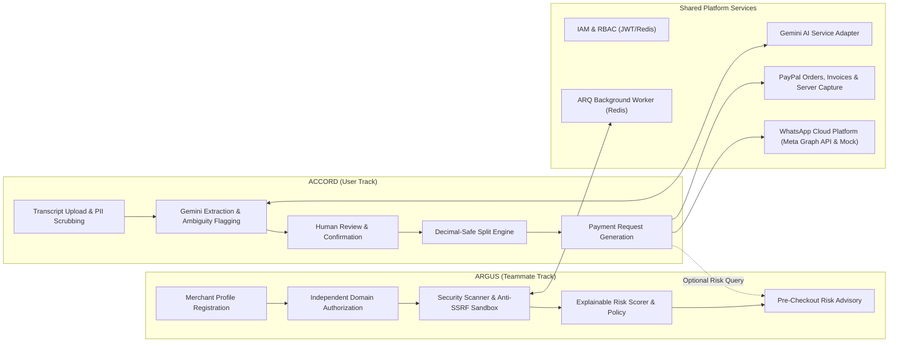

# VERITAS System Integration & Cross-Product Synergy Plan

## 1. Integration Philosophy & Domain Independence

ACCORD and ARGUS are architected with **domain isolation** and **clear shared interfaces**:
- **Independent Implementability:** ACCORD and ARGUS operate independently with mock modes (`MOCK_PAYPAL=true`, `MOCK_WHATSAPP=true`).
- **Graceful Fallback:** If ARGUS is offline or a domain is unverified, ACCORD checkout falls back to standard PayPal payment options without blocking.
- **Shared Platform Core:** Both products leverage `core` for IAM, PostgreSQL, Redis, ARQ background workers, Google Gemini AI adapter, and PayPal Sandbox payments.

---

## 2. Phased Integration Roadmap

### Phase 1: Shared Foundation (Core MVP)
- **Duration:** Weeks 1–2
- **Deliverables:**
  - Docker Compose (PostgreSQL 16 with schemas `core`, `accord`, `argus` + Redis 7).
  - ARQ background worker architecture with Redis connection pool and retry policies.
  - Base Alembic migrations.
  - Core IAM & RBAC: User registration, login, JWT issuance, refresh tokens, role dependencies.
  - User consent tracking: WhatsApp notification opt-in management.
  - **Google Gemini AI Adapter:** Provider-independent interface (`BaseAIProvider`) and Gemini implementation with structured Pydantic schemas.
  - **PayPal Developer Platform Broker:** Orders API, Invoicing API, server-side capture, and official webhook verification (`/v1/notifications/verify-webhook-signature`) with `MOCK_PAYPAL=true`.
  - WhatsApp Gateway: Signature verification (`X-Hub-Signature-256`) and template dispatcher with `MOCK_WHATSAPP=true`.
  - Frontend Scaffolding: React + Vite + TypeScript + Tailwind shell, authentication provider, and PayPal JavaScript SDK wrapper.

---

### Phase 2: Independent Feature Development (Core MVP)
- **Duration:** Weeks 3–5
- **Parallel Work Streams:**
  - **Track A: ACCORD (Assigned to You / User):**
    - Transcript ingestion supporting `.txt` exports and text with PII scrubbing.
    - Gemini AI extraction pipeline producing draft agreements and ambiguity warnings.
    - Two-phase confirmation lifecycle: Draft $\to$ Participant Review $\to$ Confirmed.
    - Natural language financial query endpoint (`POST /api/v1/accord/agreements/{id}/query`).
    - Decimal-safe expense split engine with penny-rounding balancing.
    - Explicit trigger for payment requests (`POST /api/v1/accord/agreements/{id}/generate-payment-requests`).
    - PayPal Invoicing integration for freelance milestone agreements.
    - Server-side capture integration (`POST /api/v1/payments/paypal/capture-order/{id}`).
    - User deletion endpoint (`DELETE /api/v1/accord/conversations/{id}`).
    - ACCORD Frontend Views: Transcript uploader, ambiguity review, interactive split matrix, PayPal checkout modal.
  - **Track B: ARGUS (Assigned to Teammate):**
    - Merchant profile registration (`POST /api/v1/argus/merchants`).
    - **Independent per-domain authorization:** Challenge creation (`DNS_TXT`, `HTTPS_META_TAG`) and validation worker.
    - Automated security scanning worker for authorized domains (SSL/TLS, security headers, DNSSEC/SPF/DMARC, Safe Browsing).
    - Anti-SSRF scanner sandbox: Pre-resolution DNS check blocking loopback, private RFC 1918, and cloud metadata (`169.254.169.254`).
    - Explainable risk assessment engine computing $0-100$ heuristic score, discrete `risk_level`, explicit `payment_allowed` policy, and Gemini evidence summary.
    - Pre-checkout risk assessment API (`POST /api/v1/argus/risk/assess`).
    - ARGUS Frontend Views: Merchant dashboard, domain verification manager, scan report scorecard.

---

### Phase 3: Cross-Domain Interoperability & Integration (Core MVP)
- **Duration:** Weeks 6–7
- **Integration Points:**
  1. **ACCORD $\leftrightarrow$ ARGUS Interoperability:**
     - ACCORD payment checkout queries `app.core.interfaces.argus_interface.get_domain_risk_advisory(domain)` when a split beneficiary is an authorized merchant.
     - The checkout UI displays the explainable risk checklist and respects the `payment_allowed` policy.
  2. **WhatsApp Opt-In Notification Loop:**
     - Dispatches agreement confirmation cards and payment links strictly to consenting participants.
  3. **End-to-End Payment Settlement:**
     - Complete flow: Debtor authorizes via PayPal JS SDK $\to$ Backend captures server-side $\to$ Webhook reconciles payment $\to$ Obligation updated to `PAID`.

---

### Phase 4: Security Hardening & Staging Validation (Core MVP)
- **Duration:** Week 8
- **Validation Activities:**
  - Anti-SSRF penetration testing against scanner endpoints (validating rejection of `127.0.0.1`, `169.254.169.254`, `10.0.0.1`).
  - PayPal official webhook signature verification stress tests and replay rejection.
  - ARQ worker failure, timeout, and retry recovery testing.
  - Transcript retention and Right-to-be-Forgotten deletion verification.

---

## 3. End-to-End MVP Demonstration Test Specification (IT-E2E)

| Step | Action | Executing Component | Expected Result |
| :---: | :--- | :--- | :--- |
| **1** | Upload chat export (`.txt`) | ACCORD Ingestion Router | Transcript ingested, PII scrubbed, conversation created in `PENDING` status. |
| **2** | Extract agreement | ARQ Worker + Gemini API | Structured draft agreement generated with terms, obligations, splits, and ambiguity flags. |
| **3** | Human Review & Confirmation | ACCORD Agreement Router | Creator and participants confirm terms; agreement status transitions to `CONFIRMED`. |
| **4** | Generate Payment Requests | ACCORD Payment Router | Explicit action creates PayPal Orders (`intent: CAPTURE`) and sends WhatsApp notices. |
| **5** | Debtor Authorization | Frontend PayPal JS SDK | Debtor approves transaction in PayPal Sandbox checkout modal. |
| **6** | Server-Side Capture | Core Payments Router | Backend invokes PayPal capture API, verifies amount matches specific payment request & obligation (not group total), sets status `PAID`. |
| **7** | Webhook Synchronization | Core Webhooks Router | Official signature verified, event idempotently logged, settlement reconciled. |
| **8** | WhatsApp Notifications | Core WhatsApp Gateway | Debtor receives receipt template; creator receives settlement confirmation. |
